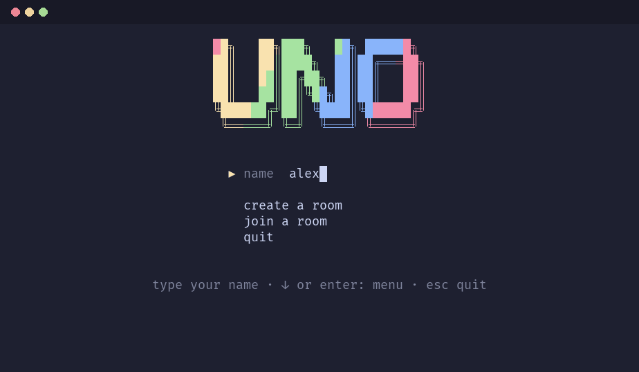
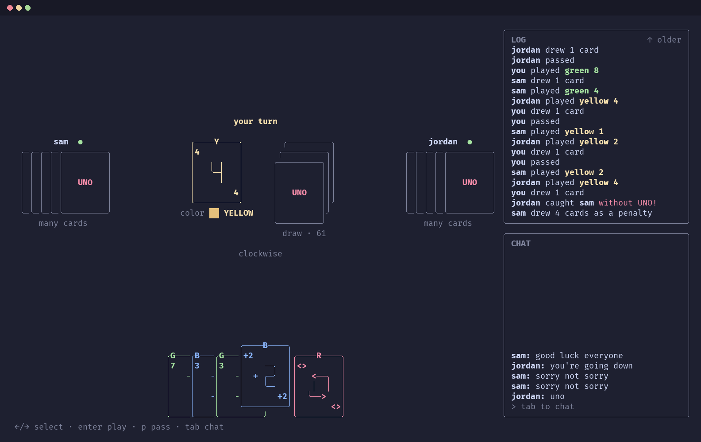
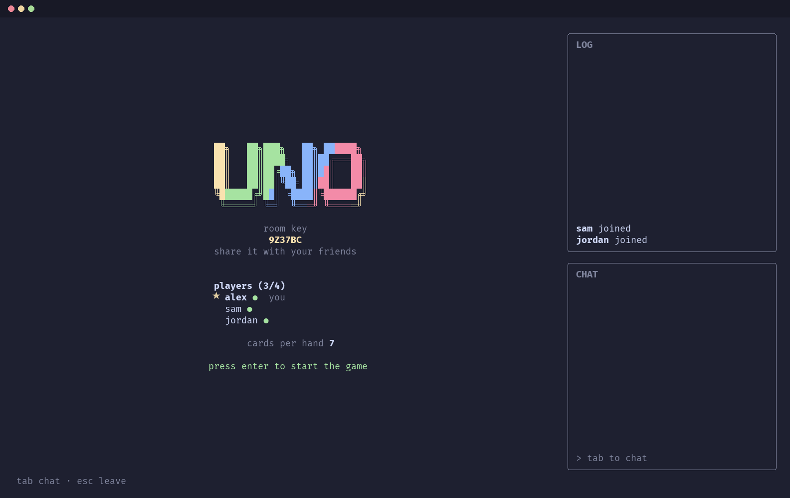
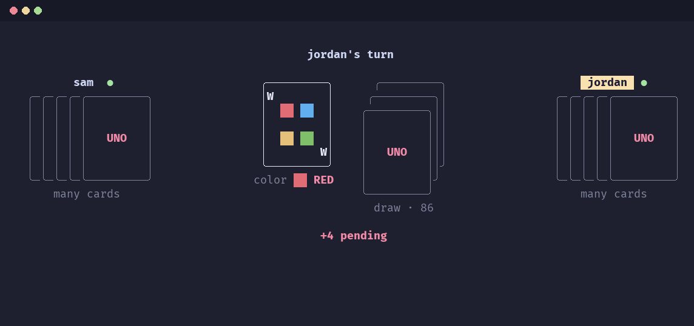
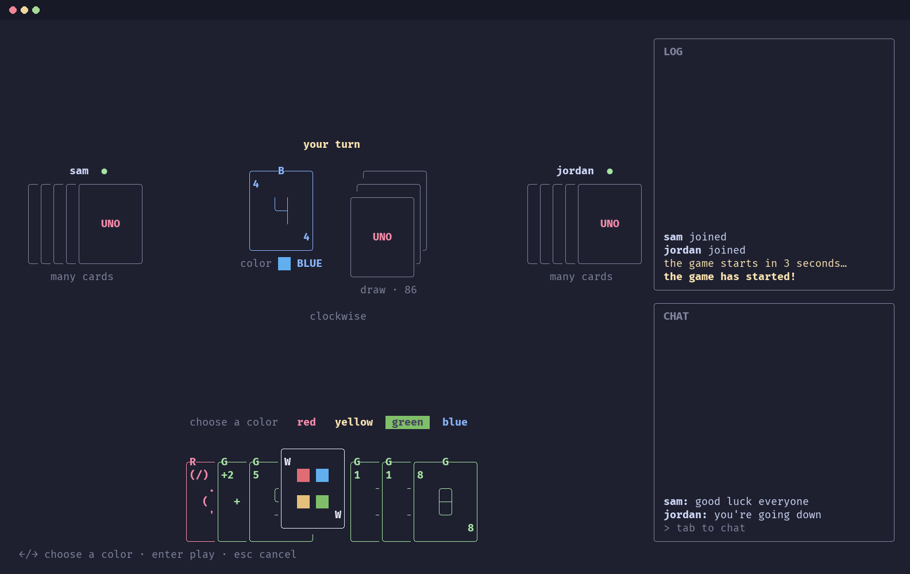
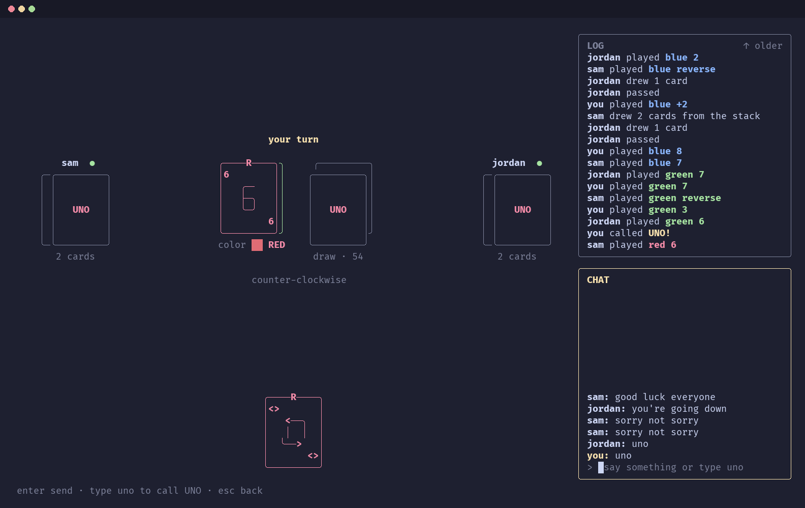
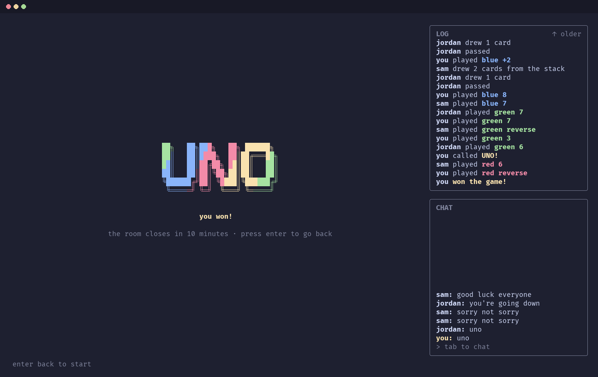
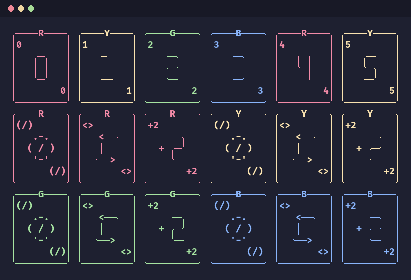
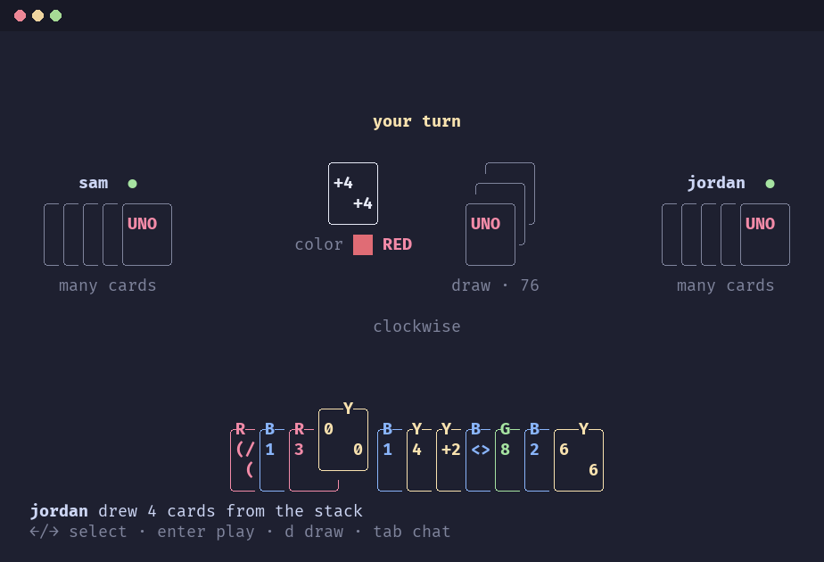
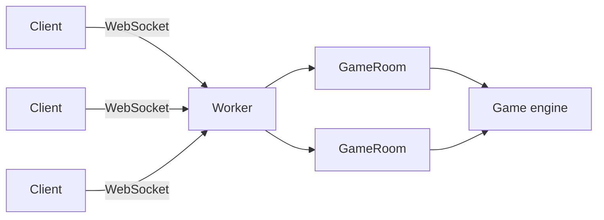

<h1 align="center">UNO</h1>

<p align="center">
  <b>The classic card game, played with friends in your terminal.</b>
</p>

<p align="center">
  
  
  
  
</p>

<p align="center">
  <a href="#features">Features</a> ·
  <a href="#getting-started">Getting started</a> ·
  <a href="#how-to-play">How to play</a> ·
  <a href="#architecture">Architecture</a> ·
  <a href="#development">Development</a>
</p>

<p align="center">
  
</p>

<p align="center">
  
</p>

## Introduction

UNO brings the classic card game to the command line. Start a room, send the six-character key to your friends, and you're playing together within seconds, each from your own terminal. There's a chat for trash talk, cards that slide across the table, and a race to type `uno` before anyone catches you.

Under the hood, the server runs on [celld](https://celld.dev), a self-hosted runtime for Cloudflare Workers and Durable Objects. Each room gets its own Durable Object, which keeps the game, the connections and the timers together in one place. A room deals with one move at a time, so two players can never trip over each other, and since everything is saved as it happens, a game carries on even if the server restarts.

The rules live in a small, pure engine that checks every move before it counts, and the server makes sure each player only ever sees their own hand. The client is built with [Ink](https://github.com/vadimdemedes/ink), which brings React to the terminal.

## Features

<table>
  <tr>
    <td width="60%"></td>
    <td width="40%">
      <h3>Rooms with shareable keys</h3>
      Create a room, choose a hand size and share its six-character key with your friends. The host starts the game once everyone has joined.
    </td>
  </tr>
</table>

<table>
  <tr>
    <td width="40%">
      <h3>A living table</h3>
      Opponents sit around the table, and every card you play slides smoothly onto the pile.
    </td>
    <td width="60%"></td>
  </tr>
</table>

<table>
  <tr>
    <td width="60%"></td>
    <td width="40%">
      <h3>Stacking and wild cards</h3>
      Stack +2 on +2 and +4 on +4 to pass the penalty along to the next player, and choose a new color whenever you play a wild card.
    </td>
  </tr>
</table>

<table>
  <tr>
    <td width="40%">
      <h3>Call UNO in chat</h3>
      Type <code>uno</code> in the chat when you are down to one card. If you forget, any other player can catch you and make you draw four cards.
    </td>
    <td width="60%"></td>
  </tr>
</table>

<table>
  <tr>
    <td width="60%"></td>
    <td width="40%">
      <h3>Every move on record</h3>
      A scrolling log records every play, draw and UNO call through to the final card. A player who drops out keeps their seat for 30 seconds while the client reconnects automatically.
    </td>
  </tr>
</table>

## Getting started

### Prerequisites

- [Node.js](https://nodejs.org) 22 or later
- [Podman](https://podman.io) or [Docker](https://www.docker.com) with Compose
- A terminal that is at least 80 columns wide and 24 rows tall

### Installation

```sh
git clone https://github.com/BattleBaxx/uno.git
cd uno
npm install
```

### Hosting a game

One player starts the server, which listens on port `8787`:

```sh
podman compose up -d    # or: docker compose up -d
```

### Joining a game

Every player, including the host, starts a client:

```sh
npm start -w @uno/client
```

The client connects to a server on the same machine by default. To join a server elsewhere on your network, pass its address with `--server` or set the `UNO_SERVER` environment variable:

```sh
npm start -w @uno/client -- --server http://192.168.1.20:8787
```

## How to play

1. Enter your name, then create a room and choose a hand size, or join an existing room with its key.
2. Share the room key with the other players. Once everyone has joined, the host presses <kbd>Enter</kbd> to begin.
3. On your turn, play a card that matches the top of the pile by color or by symbol, or play a wild card. The first player to empty their hand wins.

### Controls

| Key | Action |
|---|---|
| <kbd>←</kbd> <kbd>→</kbd> | Select a card |
| <kbd>Enter</kbd> | Play the selected card |
| <kbd>D</kbd> | Draw a card |
| <kbd>P</kbd> | Pass after drawing |
| <kbd>Tab</kbd> | Switch between your hand and the chat |
| <kbd>↑</kbd> <kbd>↓</kbd> | Scroll the chat while it is focused |
| <kbd>PgUp</kbd> <kbd>PgDn</kbd> | Scroll the game log |
| <kbd>Esc</kbd> | Cancel, or leave the room |

The bottom line of the screen always lists the actions that are currently available.

### Calling UNO

When you play your second-to-last card, you must type **`uno`** in the chat within 30 seconds. You have a three-second grace period, after which any other player can type `uno` to catch you, and you draw four cards as a penalty. Calling UNO when no player is down to one card also costs you four cards.

### House rules

The game follows the standard UNO rules with a few changes:

- A +2 can be stacked on a +2, and a +4 can be stacked on a +4, but the two cannot be mixed.
- A Wild +4 can be played at any time and cannot be challenged.
- After drawing a card, you may play any playable card from your hand or pass.
- In a two-player game, a Reverse card acts as a Skip.
- You cannot win a game without calling UNO.

The complete rules are documented in [RULES.md](RULES.md).

## The deck

Every card is drawn with box-drawing characters and labelled with its color letter, so color-blind players can tell the cards apart.

<p align="center">
  
</p>

The layout adapts to any terminal from 80×24 upwards, and the cards switch to a compact style when space is tight.

<p align="center">
  
</p>

## Architecture



The project is an npm workspaces monorepo with four packages:

| Package | Description |
|---|---|
| `libs/engine` | The game rules, implemented as pure and deterministic functions. |
| `libs/protocol` | The message schemas shared by the client and server, validated with Zod. |
| `apps/server` | The Worker and the `GameRoom` Durable Object, which handle connections, timers, chat and storage. |
| `apps/client` | The terminal client, built with [Ink](https://github.com/vadimdemedes/ink). |

## Development

```sh
npm test                       # run the test suites of all packages
npm run typecheck              # type-check all packages
npm run demo -w @uno/client    # preview every card design
```
